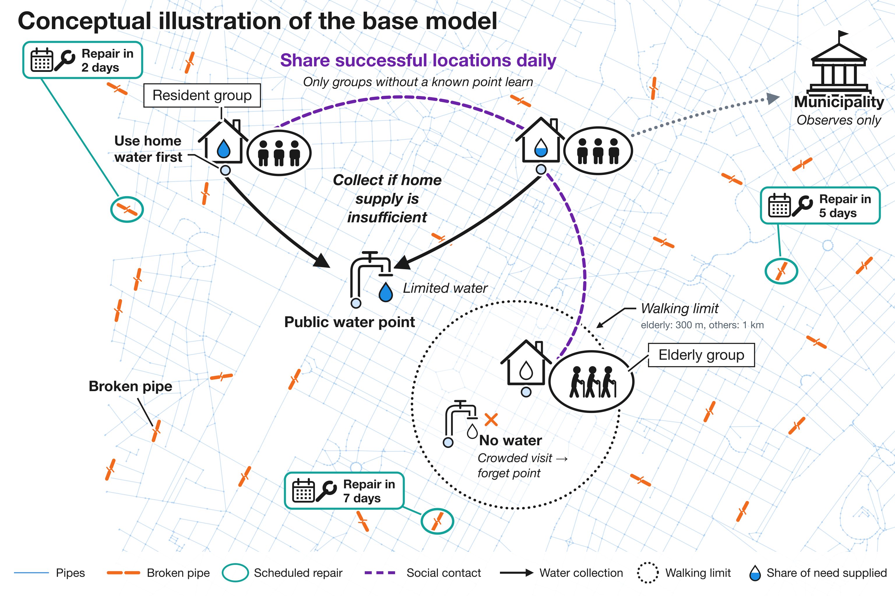
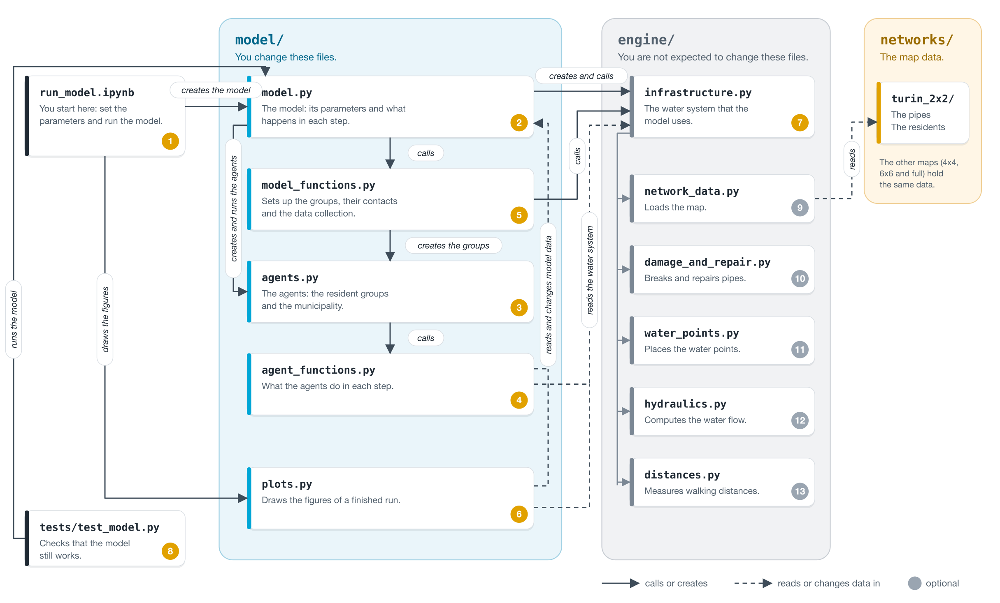

# SEN1211 base model: start here

This is the base model for your final project, *Community recovery after a water supply disruption*. Read this file first. It explains what
the model does, how the code is organised, how to read and change it, and how to run it.

## Contents

| Section | What you find there |
|---|---|
| [1. Model overview](#1-model-overview) | What the model is about and what the conceptual figure shows. |
| [2. Architecture of the codebase](#2-architecture-of-the-codebase) | How the files fit together and how the hydraulic simulation runs in the background. |
| [3. How to read and change the codebase](#3-how-to-read-and-change-the-codebase) | In which order to read the code, where to start when you want to change something, how to add a new agent type, how to check your changes and which Mesa tools the code uses. |
| [4. How to run the model and change parameters](#4-how-to-run-the-model-and-change-parameters) | How to install and run the model, which parameters and map sizes you can choose, and how to read the results. |

## 1. Model overview

This model looks at how residents of Turin get water after a disaster has damaged the
water network. At the start of a run, some pipes break at random. The model then
calculates how much water still reaches homes and public water points. You can run it on
four maps, from a small part of Turin to the full city.



The figure shows the main parts of the model. Residents are not modelled one by one.
Instead, the residents who live at the same junction are put into groups, and each group is
one agent that decides for all its members. The total population comes from the map. The
parameter `people_per_group` sets how many residents a group holds, which is 10 by default.
Groups are either elderly or other residents, and the main difference between them is how
far they can walk: 300 metres for elderly groups and 1 kilometre for others.

Each group first uses the water that reaches its home through the pipes. When that is not
enough, it walks to the public water point it knows to collect the rest. A water point only
has a limited amount of water, so when many groups go to the same point, some of them may
leave with nothing. A group that finds no water forgets that point and has to find another
one.

Groups can find a new point through their social contacts. Once a day, a group that does not
know a working point can learn one from a contact who recently got water there, as long as
the point is within its walking distance. In the meantime, the broken pipes are repaired
according to a fixed schedule, and the water supply improves after each repair. A
municipality observes how many groups are without a water point, but it does not act. It is
included as an example of another agent type that you can develop.

The rules are kept simple on purpose so that you can understand them and change them for
your own research question.

## 2. Architecture of the codebase

The code map shows which file uses which. A solid arrow means that a file calls or
creates something in another file. A dashed arrow means that it reads or changes data
there.



| Folder | File | What it is | What it calls or reads | Why |
|---|---|---|---|---|
| Start | `run_model.ipynb` | The notebook. You set the parameters and run the model here. | `model/model.py`, `model/plots.py` | To create and run a model and draw its figures. |
| `model/` | `model.py` | `WaterAccessModel`: the parameters, the set-up in `__init__` and `step()`. | `model_functions.py`, `agents.py`, `engine/infrastructure.py` | To build the model and run the agents' rules in a fixed order in every step. |
| `model/` | `model_functions.py` | The set-up steps and calculations. | `agents.py`, `engine/infrastructure.py` | To check the parameters, create the groups, link their social contacts and record the results. |
| `model/` | `agents.py` | The agent classes `ResidentGroup` and `Municipality` and their attributes. | `agent_functions.py` | Each rule method hands the work to a function there. |
| `model/` | `agent_functions.py` | The agent rules: what a group or the municipality does in a step. | `model.py`, `engine/infrastructure.py` | To read the home supply and the water left at each point, and to update the water left. |
| `model/` | `plots.py` | The figures of a finished run. | `model.py`, `engine/infrastructure.py` | To draw the maps, time series and comparisons. |
| `engine/` | `infrastructure.py` | The water system, available as `water_model.infrastructure`. | `network_data.py`, `damage_and_repair.py`, `water_points.py`, `hydraulics.py`, `distances.py` | So the model has one place to ask for water supply, distances, repairs and new points. |
| `engine/` | `network_data.py` | Loads the map. | `networks/<map>/water.inp`, `networks/<map>/resident_units.csv`, `networks/<map>/info.json` | To read the pipes, the residents per junction and the data sources. |
| `engine/` | `damage_and_repair.py` | Breaks and repairs pipes. | None | To set the damage and the repair schedule. |
| `engine/` | `water_points.py` | Places the public water points. | None | To choose the junctions for the points in each district. |
| `engine/` | `hydraulics.py` | Calculates the water flow with EPANET, through WNTR. | None | To find how much water each home and point receives. |
| `engine/` | `distances.py` | Measures walking distances. | None | To find which points each home can reach. |
| `networks/` | `turin_2x2/`, `turin_4x4/`, `turin_6x6/`, `turin_full/` | One folder per map: `water.inp` (the pipes), `resident_units.csv` (the residents per junction), `districts.csv` and `info.json` (the map size and data sources). See [Map sizes](#map-sizes). | None | The input data of the model. |
| `tests/` | `test_model.py` | Checks of what the model should do. | `model/model.py` | To run the model and show that it still works after you change it. |

### The hydraulic simulation runs in the background

The hydraulic simulation is already built for you. It uses WNTR, a Python package for
hydraulic simulation of water networks, and runs from `engine/infrastructure.py`. The model
runs it once at set-up. It runs again in every step in which a scheduled repair finishes,
and each time an agent calls `repair_pipe` or `open_water_point`.

## 3. How to read and change the codebase

Read the files in this order. Files 9 to 13 are optional.

| Order | File | Are you supposed to modify it? |
|---|---|---|
| 1 | `run_model.ipynb` | Yes: the parameters and your experiments. |
| 2 | `model/model.py` | Yes. Read `step()` first. Change this file to add steps or agent types, or to change the order in which agents act. |
| 3 | `model/agents.py` | Yes, to add attributes or agent types. |
| 4 | `model/agent_functions.py` | Yes. The behaviour rules are here, so start here when you want new behaviour. |
| 5 | `model/model_functions.py` | Yes, to change how groups and contacts are created, or what Mesa records. |
| 6 | `model/plots.py` | Yes, to add or change figures. |
| 7 | `engine/infrastructure.py` | No. Read it to see which methods your agents can call, such as `repair_pipe`. To open a water point, call `open_water_point` in `model/model.py`. |
| 8 | `tests/test_model.py` | Yes. Add a test for every mechanism you change. |
| 9–13 | The other `engine/` files | No. |

### Where to start a change

Start from your research question and choose the assumptions that suit it. You can
change or replace any supplied rule.

| What you want to change | Where to start |
|---|---|
| The map, step length, profiles or residents per agent | The parameter cell in `run_model.ipynb` |
| How groups are created | `create_groups` in `model/model_functions.py` |
| How a group chooses a point | `choose_water_point` in `model/agent_functions.py` |
| What happens when a point is crowded | `collect_water` in `model/agent_functions.py` |
| What contacts share and how a group uses it | `learn_from_contacts` in `model/agent_functions.py` |
| A new profile setting, such as trust | Add it to every profile in the parameter cell. Read it with `group.model.profiles[group.profile]["trust"]` |
| When groups decide and exchange information | `step()` in `model/model.py` |
| The structure of the social network | `nx.barabasi_albert_graph(...)` in `link_social_network` in `model/model_functions.py` |
| A repair crew, utility or municipality that acts | `water_model.infrastructure.repair_pipe(pipe_name)` repairs a pipe at once. It works only with `recovery_days=None`. `water_model.open_water_point(junction_name)` opens a new water point. No group knows the new point, so your agent must set `known_water_point` for the groups it informs. |
| A new agent type | [Add an agent type](#add-an-agent-type) |
| What Mesa records, such as crowded points | Add a reporter in `set_up_data_collection` in `model/model_functions.py` |

### Add an agent type

Use `Municipality` as your example.

| Step | File | What to add |
|---|---|---|
| 1 | `model/agents.py` | The class. |
| 2 | `model/agent_functions.py` | Its rules. |
| 3 | `model/model.py` | Create the agent during set-up. |
| 4 | `model/model.py` | A set of the new agents, such as `self.municipalities = self.agents_by_type[Municipality]`. |
| 5 | `model/model.py` | A call of its rule in `step()`, such as `self.municipalities.do("observe_city")`. |

The group rules and results use `self.groups`, which contains only `ResidentGroup`
agents, so a new agent type does not change them.

### Check your changes

Run the tests from `Base_model/` after every change:

```bash
python -m pytest tests -q
```

### Mesa tools used in the code

Every line that uses one of these Mesa tools has a comment starting with `Mesa:`. The
[Mesa AgentSet documentation](https://mesa.readthedocs.io/stable/apis/agentset.html)
explains the agent-set tools.

| Mesa tool | What it does | Where |
|---|---|---|
| `Model` | Provides the base class for a simulation, with its agents, clock and random numbers. | `model.py` |
| `CellAgent` | Defines an agent that occupies a cell and can move between cells. | `agents.py`, `ResidentGroup` |
| `Agent` | Defines an agent without a position in a space. | `agents.py`, `Municipality` |
| `move_to(cell)` | Moves an agent to another cell. | `agent_functions.py` |
| `Network` | Defines a space with one cell per water-network node, including every junction, reservoir and tank. | `model.py`, set-up 3 |
| `super().__init__(model)` | Adds a new agent to the model and assigns its number, `unique_id`. | `agents.py` |
| `self.cell` | Refers to the cell occupied by the agent. Set it to place the agent. | `agents.py` |
| `self.model` | Gives an agent access to the shared model. | `agent_functions.py`, written as `group.model` |
| `ResidentGroup(...)` | Creates an agent and adds it to the model. | `model_functions.py`, `create_groups` |
| `water_space[junction]` | Returns a junction's cell in the `Network` space. | `model_functions.py`, `create_groups` |
| `agents_by_type[ResidentGroup]` | Contains all agents of one type. | `model.py`, set-up 4 |
| `do("rule")` | Runs the rule once for each agent in the set. | `model.py`, `step()` |
| `shuffle_do("rule")` | Runs the rule once for each agent in the set, in a new random order each step. | `model.py`, `step()` |
| `agg("attribute", sum)` | Sums one attribute across all agents in the set. | `model.py`, `step()` |
| `rng=` | Sets the seed for the model's random numbers. | `model.py`, notebook section 2 |
| `self.random` | Provides the seeded random-number generator shared by the model and agents. | both files |
| `self.time`, `self.steps`, `self.running` | Track the clock, the step count and the stop signal. | `model.py`, `step()` |
| `DataCollector` | Records selected values, called reporters, in tables when you call `collect()`. | `model_functions.py`, `set_up_data_collection` |
| `[function, [values]]` reporter | Records the result of calling a function with these values. Here, it creates one column per profile. | `model_functions.py`, `set_up_data_collection` |
| `agenttype_reporters` | Record selected attributes for every agent of one type at each step. | `model_functions.py`, `set_up_data_collection` |
| `get_model_vars_dataframe()`, `get_agenttype_vars_dataframe(...)` | Return the recorded results as pandas tables. | The first in notebook section 2, the second in `tests/test_model.py` |
| `mesa.__version__` | Reports the installed Mesa version. | notebook, first code cell |
| `run_for(n)` | Advances the clock by `n` time units and calls `step()` once per unit. | notebook, section 2 |
| `batch_run` | Runs multiple models with different parameter values and seeds. | notebook, section 5 |

## 4. How to run the model and change parameters

| Step | What to do |
|---|---|
| 1 | Use Python 3.12 or newer. From this folder, run `pip install -r requirements.txt`. If you use Jupyter, also run `pip install notebook`. For help with installing, see the [installation guide on Brightspace](https://brightspace.tudelft.nl/d2l/le/lessons/878532/topics/5194004). |
| 2 | Open `run_model.ipynb` in Jupyter or VS Code and select the Python environment in which you installed the packages. |
| 3 | Set the parameters in the parameter cell and run the cells from top to bottom. |

| Parameter | What it sets |
|---|---|
| `network_name` | The map: `"turin_2x2"`, `"turin_4x4"`, `"turin_6x6"` or `"turin_full"`. Start with the smallest. |
| `time_step_hours` | The hours per step: `1`, `6` or `24`. |
| `simulation_days` | The number of days to simulate, for example `20`. |
| `people_per_group` | The target number of residents per agent, for example `10`. |
| `profiles` | Each resident profile, with its fraction of residents and its walking distance. |
| `share_information` | Whether groups learn from their contacts: `True` or `False`. |
| `random_seed` | The seed passed to Mesa's `rng` parameter, for example `42`. The same seed gives the same run. |

You can set every other parameter of `WaterAccessModel` (in `model/model.py`) in the
notebook as well. The run cell keeps the number of simulated days the same when you
change the step length: a 20-day run has 480 hourly steps, 80 six-hour steps or 20 daily
steps.

### Map sizes

Start with `turin_2x2` while you build and test your model, and move to a larger map once
it works. Changing `network_name` is enough: the model then reads that map's residents,
creates the groups with the same `people_per_group` and `profiles`, places the water
points and runs the hydraulic simulation for that map. Larger maps have fewer very small
junctions, so the average group comes closer to `people_per_group`. The run times below
are for one default run (20 days, 6-hour steps, seed 42) on an Apple Silicon laptop. Your
computer may be slower, and hourly steps take longer.

| Map | Size | Junctions | Pipes | Districts | Residents | Resident groups | Water points | Run time |
|---|---|---|---|---|---|---|---|---|
| `turin_2x2` | 2 × 2 km | 1,134 | 1,596 | 4 | 26,115 | 3,402 | 16 | about 5 s |
| `turin_4x4` | 4 × 4 km | 3,472 | 4,897 | 16 | 104,446 | 12,913 | 64 | about 16 s |
| `turin_6x6` | 6 × 6 km | 6,268 | 8,684 | 35 | 235,021 | 27,182 | 140 | about 33 s |
| `turin_full` | 14 × 14 km | 14,996 | 19,659 | 127 | 849,118 | 92,469 | 476 | about 75 s |

### Understand the results

| Result | What it measures |
|---|---|
| `Water need met (%)` | How much of the required **water volume** groups received at home or at a point during the step. It is not the percentage of households whose full need was met. |
| `Water need met, elderly (%)` and the other profiles | The same measure for each profile. |
| `Groups without a point (%)` | The share of groups that know no point. Each group has equal weight. |
| `Broken pipes` | The number of pipes still broken. |
